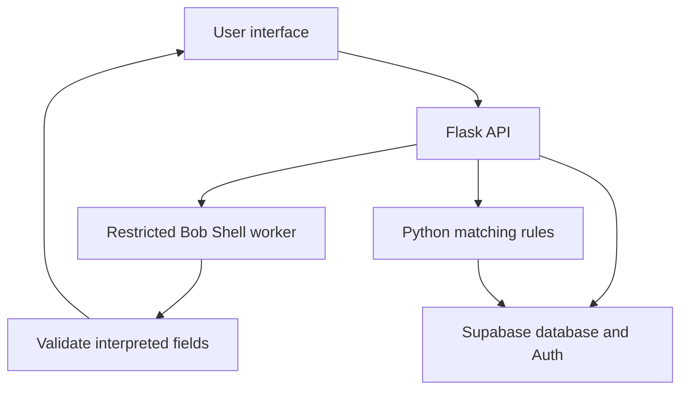

# Community Food Sharing — Product and Technical Plan

**App name:** To be decided  
**Prepared:** October 23, 2026  
**Focus:** Sustainability and community food sharing  
**Status:** Proposed product and architecture. Bob integration and app behavior have not yet been tested.

## 1. Purpose and intended users

Help anyone in the community keep surplus household ingredients from becoming waste. People can exchange groceries, give them away, or find a suitable local donation option. For food that can no longer be eaten safely, provide locally appropriate composting or organics guidance.

The app is for the whole community. Students are one possible user group, not an eligibility restriction. Sustainability and preventing waste are the primary outcomes; saving money and connecting neighbors are supporting benefits.

**Proposed distinguishing feature:** When an exchange fails, help the owner take the next practical step while there is still time for a handoff. Suggest another compatible match, an owner-approved giveaway, or a suitable donation destination. Do not automatically change the owner's listing mode or claim a donation happened.

Food sharing and compost directories already exist. The proposed emphasis is practical follow-through: helping each ingredient reach a useful destination when an initial match falls through. This is a product direction, not a verified claim of uniqueness.

**Main user journey:** Describe surplus food → review the interpreted details → choose Exchange or Giveaway → set pickup availability → receive a compatible offer → accept or decline → confirm the completed handoff → update the Impact Ledger.

## 2. Technology stack and architecture decisions

- **Frontend:** HTML, CSS, and JavaScript.
- **Backend:** Python Flask.
- **Database and authentication:** Supabase and Supabase Auth. No MySQL.
- **Bob requirement:** IBM Bob must run during an app interaction, not only help generate the code.
- **First Bob feature:** Interpret a natural-language surplus listing and return editable fields.
- **Matching and transactions:** Deterministic Python and database logic enforce compatibility, quantities, permissions, deadlines, and status transitions.
- **Pickup:** General pickup zones and time windows. Avoid publishing exact home addresses.
- **Pilot:** One local area and a small manually researched destination directory.
- **Development workflow:** Bob can also assist with implementation, debugging, and testing. Maintain the application code in a shared Git repository.
- **Hosting:** Use an environment that can run Flask and the installed Bob Shell executable. Verify runtime compatibility, authentication, and response latency before choosing a host.

## 3. Product features and initial scope

| Feature | Initial version | Future enhancements |
|---|---|---|
| Accounts | User sign-up and sign-in through Supabase Auth | Social login and profile customization |
| Listings | Exchange or Giveaway; quantities; pickup zone; availability deadline and time window | Photo upload and advanced filters |
| Bob interpretation | Live request turns text into editable food and pickup fields | Images, multilingual input, richer conversation |
| Bundles | Up to five items, offered together to one recipient | Splitting a bundle or item quantities among recipients |
| Requests | One wanted food per exchange listing and standalone requests for specific ingredients | Multiple alternatives, substitutions, and sophisticated quantities |
| Matching | Food compatibility, quantity/unit compatibility, shared pickup zone, overlapping availability | Route optimization, three-party trades, fairness/value optimization |
| Offers | Fixed contents, Accept/Decline, both parties' acceptance for exchanges | More flexible pickup rescheduling |
| Giveaways | Recipient requests; owner approves | Complex queues or allocation policies |
| Fallback | Re-check alternatives after a decline; offer owner-approved giveaway and directory recommendations | Background notifications and live organizational integrations |
| Completion | Both parties confirm handoff; external donation/composting is user-reported | Independent organization verification |
| Impact | Completed handoffs and clearly labeled reported outcomes | Money and emissions estimates |
| Trust | Owner permissions and food-condition confirmation | Ratings, reporting/blocking workflows, moderation dashboard |

Ratings and moderation should be addressed before a broader public rollout. Ratings should be available only after a completed handoff; users should be able to report or block other users.

## 4. Bob's role inside the app

IBM documents non-interactive Bob Shell calls through `bob run`, machine-readable output through `--format json`, and authentication using `BOB_API_KEY` [1–3]. This plan proposes wrapping that documented interface in a Flask endpoint. It does not assume a ready-made public “Bob food-matching API.”

### Integration validation

1. Confirm which Bob Shell version the team has and that an inference API key is available in the team's Bob account. Current documentation says trial and paid users can create keys [3]. Desktop sign-in alone does not authenticate non-interactive calls [1].
2. Install and authenticate Bob Shell on the same machine or service that will execute the backend. Current installation documentation lists Node.js 24 or later; follow the requirements for the installed version [2].
3. Send a food-listing request and inspect the actual response and latency.
4. Call Bob from Flask and display the interpreted fields in a browser.
5. Verify repeated requests and failure handling before relying on the integration.

If the integration is unavailable, investigate account access, version differences, and the supported execution route using IBM's documentation and support. Manual entry can keep listing creation available, but the product's Bob-powered interpretation remains unavailable until a real runtime connection works.

### User-facing example

Input: “I have five onions and one unopened bag of rice. I can meet at the library Friday from 3 to 5.”

Bob should extract candidate food names, quantities, package condition, pickup zone, and time phrases. Leave missing values unknown. Ask the user to resolve ambiguities such as AM/PM, the exact Friday date, bag weight, or whether a date is a best-by date or an availability cutoff. Use the user's local timezone.

The app shows the interpreted fields for review. It saves a listing only after the user confirms them.

### Proposed architecture

### Integration contract and boundaries

- Suggested endpoint: `POST /api/interpret-listing`.
- Flask supplies a fixed extraction instruction and the user's description as data.
- Invoke the executable with an argument list and pass input through standard input; do not build shell commands from user text.
- Use a restricted worker with an isolated empty workspace. Keep Supabase administrative credentials out of that worker.
- Disable unnecessary tool groups, including file read/edit, command execution, MCP, skills, subagents, and mode switching. IBM documents these restrictions [4]. A prompt saying “do not use tools” is not a substitute for configuring them.
- Set input-length limits, a request timeout, and appropriate turn/cost limits.
- Bob's JSON output is a session envelope. Its `last_message` is text; requesting JSON within that message does not guarantee your application schema. Parse and validate the extracted content before using it [1].
- Reject malformed output, impossible quantities, and invented fields. Preserve the user's original text so they can correct the form.
- On timeout or failure, show a clear retry/manual-entry option and leave the listing unsaved.
- Keep `BOB_API_KEY` on the server. Show users the interpreted content, not raw logs or credentials.

**Additional Bob capability:** Explain or rank a small set of candidates already validated by Python. Return only supplied candidate IDs and grounded reasons; revalidate before creating an offer. Bob must not invent food-bank locations, opening hours, or food-safety conclusions.

## 5. Matching, offers, and fallback rules

### Candidate filtering

1. Exclude the user's own listings and unavailable, reserved, completed, or withdrawn listings.
2. Exclude listings whose availability deadline has passed.
3. Match a normalized food name and compatible units/quantities. For the MVP, require explicit quantities and avoid unsupported unit conversions.
4. For exchanges, check that each side offers the food the other side requested. For giveaways, no reciprocal item is required.
5. Require a common pickup zone and a positive overlap between pickup windows before both availability deadlines.
6. Rank valid candidates by urgency and pickup fit using simple, documented rules. If distances or travel plans are not captured, do not claim the algorithm optimizes travel.

### Offer lifecycle

- Proposed offers show the exact items, quantities, pickup zone, and overlapping time window.
- Each exchange participant can accept or decline. A giveaway requires a request followed by owner approval.
- On final acceptance, atomically verify availability and reserve every involved listing. If another offer already reserved the food, reject the conflicting confirmation and refresh alternatives.
- A decline or cancellation releases only reservations belonging to that offer. Completed quantities must never become available again.
- Both parties confirm the physical handoff before the app marks a peer exchange or giveaway completed.
- A repeated completion request must not increase the impact totals again. Tie each recorded outcome to a unique offer/item identity.

### Fallback

When an offer is declined or the owner opens an unmatched listing, re-evaluate available options. Show another compatible match where possible. Otherwise, suggest switching to Giveaway or checking a suitable donation destination. The owner decides.

In the initial version, re-evaluation happens on these interactions. Background jobs and push notifications can extend this behavior later. Surface donation alternatives early; do not wait for all pickup opportunities to close.

An expired availability deadline means the listing is unavailable. It does **not** establish that the food is spoiled. Edible food should not be sent to compost simply because an exchange failed.

## 6. Food eligibility and local destinations

Use a conservative MVP policy: whole produce in acceptable condition and unopened shelf-stable packaged food. Exclude homemade food, opened packages, and foods requiring more complex storage verification from the initial version.

Ask users to confirm condition, packaging where applicable, and appropriate storage. Do not treat the absence of visible rot as proof of safety. “Unopened” applies to packaged food, not to loose onions or apples.

Record the printed date and its label type separately from the pickup deadline. USDA guidance explains that best-by dates concern quality and are not automatic proof of spoilage [7]. For a conservative initial policy, suppress listings beyond the app's configured eligibility cutoff, while avoiding a claim that every past-date item belongs in compost. Bob never certifies food safety.

### Small directory instead of live integrations

Store manually researched records with name, destination type, location, accepted categories, exclusions, published hours, official URL, contact details where available, and `checked_at`. Filter these records using item type and pickup feasibility. Show published hours and a link to confirm current rules; do not claim live acceptance or a confirmed appointment.

| Initial directory record | Verified information to use | Scope of recommendation |
|---|---|---|
| Second Harvest of Silicon Valley — Cypress Center | Individual donations: unopened, unexpired nonperishable food; no glass. Published Cypress hours: weekdays 9:30 AM–4:30 PM [5]. | Recommend for eligible packaged goods. The page contains conflicting produce guidance, so flag produce as requiring confirmation rather than automatically recommending it. |
| Zero Waste Silicon Valley — Berger Drive | 1560 Berger Dr., San Jose. Published drop-off hours: Monday–Friday, 8:30 AM–4 PM, excluding major holidays. Accepts specified fruit/vegetable and non-greasy scraps; excludes meat, dairy, oils, and other listed materials [6]. | Recommend only accepted materials. Display exclusions and the official link. |

For unsupported locations or categories, say no verified option is currently listed. Never invent a destination. Local organics collection may be more practical than a special drop-off; only show municipality-specific guidance after checking its official rules.

## 7. Supabase data model and minimal endpoints

| Table | Minimum purpose |
|---|---|
| `profiles` | Reference Supabase Auth user; display name and general area |
| `listings` | Owner, Exchange/Giveaway mode, pickup zone/window, deadline, eligibility confirmation, status |
| `listing_items` | Listing ID, food name, quantity, unit, package details, optional printed date and date type |
| `food_requests` | User, wanted food/quantity/unit, optional linked offer listing, pickup constraints, status |
| `trade_offers` | Participants, involved listings, fixed offer, acceptance flags, reservation state, handoff confirmations |
| `donation_options` | Donation/compost destination facts, restrictions, source URL, last-checked timestamp |
| `impact_ledger` | Completed outcome, item/quantity/unit, linked offer or external destination, confirmation type, timestamp |

Keep recommendations as recommendations or offer events; they do not create completed-impact entries. Enforce owner/participant access through server checks and appropriate Supabase row-level security. Keep administrative credentials out of browser code.

Suggested endpoints: `POST /api/interpret-listing`, `POST /api/listings`, `GET /api/listings`, `POST /api/requests`, `GET /api/listings/<id>/matches`, `POST /api/offers`, `POST /api/offers/<id>/respond`, `POST /api/offers/<id>/confirm-pickup`, `GET /api/listings/<id>/fallback-options`, `POST /api/outcomes`, and `GET /api/impact`.

Agree on request/response fields before teammates implement separate components. Use one owner for schema changes.

## 8. Impact ledger: recommendations versus outcomes

| Event | Display/record | Count as completed impact? |
|---|---|---|
| A food bank is suggested | Donation recommended | No |
| Directions are opened | Directions viewed | No |
| An offer is accepted | Handoff scheduled | No |
| Both participants confirm pickup | Peer handoff confirmed | Yes, once |
| Owner reports dropping food off | Donation reported completed | Yes, explicitly user-reported |
| Owner reports accepted scraps dropped off | Composting reported completed | Yes, in a separate composting total |

The MVP reports completed handoffs and transferred quantities with their units. Do not add bags, apples, and kilograms into one misleading quantity. Record weight only when entered or supported by a documented conversion.

Keep food shared for human consumption separate from composting. Do not equate a handoff with verified consumption or a proven counterfactual reduction in waste. Money, emissions, and waste-avoided estimates can be added later with explicit assumptions and sources. Test records must be excluded from real community impact totals.

## 9. Functional acceptance criteria

- [ ] A fresh user description triggers a real Bob request; fields can be corrected before saving.
- [ ] Ambiguous dates/quantities remain unresolved until the user confirms them.
- [ ] A Bob timeout or malformed response does not save bad data or create an offer.
- [ ] A non-overlapping pickup window or past availability deadline prevents a match.
- [ ] Exchange matching checks both participants' requested foods; giveaways do not require reciprocity.
- [ ] Two competing final acceptances cannot reserve the same food twice.
- [ ] One participant cannot confirm on behalf of the other or alter unrelated offers.
- [ ] Declining an offer preserves food availability unless another valid reservation exists.
- [ ] Repeating a completion action does not double-count impact.
- [ ] A donation recommendation is not recorded as a completed donation.
- [ ] Directory exclusions are enforced; unknown destinations or facts are not invented.
- [ ] API keys and exact home addresses are absent from browser output, screenshots, and the repository.

Use targeted backend tests for matching, permissions, reservations, and duplicate completion, plus a manual two-account walkthrough. A generated test file is not evidence until the team runs it and checks the result.

## 10. Future development

Prioritize a small neighborhood pilot, food-handling policy review, reporting/blocking, verified destination maintenance, and enough nearby participants for useful matches. Then consider ratings, bundle splitting, notifications, matching around planned journeys, organization confirmations, and sourced environmental estimates.

Do not claim a “tripless match rate” until users explicitly report that they already planned to be at the pickup location. A shared pickup zone alone does not establish that no extra journey occurred.

## Sources and verification notes

Official documentation and local destination pages were reviewed on October 23, 2026. Product versions, access entitlements, destination hours, and acceptance policies can change. The CLI wrapper described above is a proposed implementation, not a tested integration or a verified general-purpose public-service deployment contract. Verify account access, runtime compatibility, and the intended deployment before implementing the integration.

1. [IBM Bob Shell — Starting a non-interactive session](https://bob.ibm.com/docs/shell/getting-started/start-bobshell-non-interactive)
2. [IBM Bob Shell — Installing and authentication](https://bob.ibm.com/docs/shell/getting-started/install-and-setup)
3. [IBM Bob Shell — API keys](https://bob.ibm.com/docs/shell/account/api-keys)
4. [IBM Bob Shell — Tools and tool groups](https://bob.ibm.com/docs/shell/core-concepts/tools)
5. [Second Harvest of Silicon Valley — Donate food](https://www.shfb.org/give-help/donate-food/)
6. [Zero Waste Silicon Valley — Organics and community drop-off](https://zerowastesv.org/materials/organics)
7. [USDA FSIS — Food product dating](https://www.fsis.usda.gov/food-safety/safe-food-handling-and-preparation/food-safety-basics/food-product-dating)
8. [EPA — Wasted Food Scale](https://www.epa.gov/sustainable-management-food/wasted-food-scale)
9. [Olio — How the app works](https://olioapp.com/en/getting-started-on-olio/discover-the-olio-app/)
10. [Peels — Community composting map](https://www.peels.org/)
